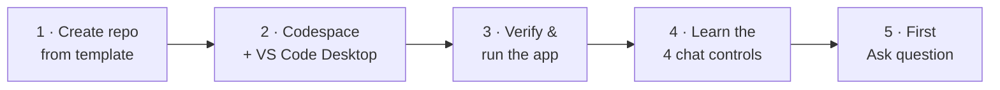
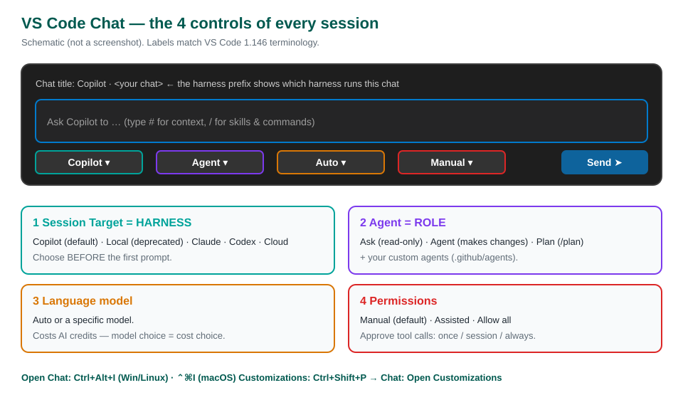

# Lab 00 · Setup & orientation

> ⏱️ **15 min** · 🎯 Everyone · 🧩 Builds on: nothing · 🆘 Stuck? See [Troubleshooting](#-troubleshooting)

## 🎯 Goal

By the end of this lab you have:

- ✅ Your **own copy** of the workshop repo running in a **Codespace** (opened in VS Code Desktop)
- ✅ The **Contoso** app running and all tests green
- ✅ A first Copilot chat where **you** chose the 4 controls on purpose

## 🗺️ Lab map



---

## Step 1 — Create your own repository (⏱️ 2 min)

**Why:** every participant needs a repo they *own* — later labs change settings (rulesets, secrets) that need admin rights.

1. Open the workshop template repository link your coach shared.
2. Click **Use this template** → **Create a new repository**.
3. **Owner:** your GitHub account (or the organisation your coach names) · **Name:** `contoso-workshop` · **Visibility:** **Private**.
4. Click **Create repository**.

> 👀 **Expected:** your repo opens at `github.com/<you>/contoso-workshop` and the **Actions** tab shows a first **CI** run (green ✅ after ~1 minute).

---

## Step 2 — Start a Codespace and open it in VS Code Desktop (⏱️ 4 min)

**Why:** the Codespace has Node 24, the GitHub CLI and the Copilot CLI preinstalled — identical for all 100 participants. VS Code **Desktop** supports every agent feature we use today.

1. In your repo: **Code** (green button) → **Codespaces** tab → **Create codespace on main**.
2. Wait until the terminal shows `Contoso workshop — environment check` (≈ 2 min).
3. Bottom-left corner: click **Codespaces** → **Open in VS Code Desktop**. Accept the prompts to open VS Code and sign in to GitHub.

> 👀 **Expected:** VS Code Desktop with `Codespaces: …` in the bottom-left corner.
> ⚠️ **Can't install/open VS Code Desktop?** Continue in the browser — almost everything works; tell your coach which step fails.

---

## Step 3 — Verify the environment and run the app (⏱️ 3 min)

1. Open a terminal: **Terminal → New Terminal** (`` Ctrl+` ``).
2. Run:
   ```bash
   npm run verify
   ```
   > 👀 **Expected:** ✅ for Node.js 24+, node:sqlite, git and *Unit tests (30 passing)*. ⚠️ on optional tools is fine.
3. Start the app:
   ```bash
   npm start
   ```
4. A notification offers to open port **3000** → **Open in Browser** (or **Ports** tab → globe icon next to 3000).
5. Click member **M-1003** (Fatima, 60 % part-time). Look at *Pensionable salary (current)*.

> 👀 **Expected:** the Contoso UI with 8 synthetic members. Remember M-1003's numbers — **one of them is wrong** (you'll fix it with an agent in lab A5).

6. Stop the app with `Ctrl+C` when you're done looking (start it again whenever you need it).

---

## Step 4 — Learn the 4 controls of every chat (⏱️ 3 min)



| Control | Analogy | Today's default |
|---|---|---|
| **Session Target** (harness) | *Which kitchen* cooks the meal | **Copilot** |
| **Agent** | *Which chef* — a waiter who only answers (Ask), a cook (Agent), a menu planner (Plan) | depends on the lab |
| **Language model** | *Which brain* the chef uses — bigger brain = better and more expensive | **Auto** |
| **Permissions** | *Who signs off* before the chef uses a knife | **Manual** |

1. Open the Chat view: `Ctrl+Alt+I` (macOS `⌃⌘I`).
2. Click **New Chat (+)**.
3. In the chat input, set — **in this order**:
   1. **Session Target** → **Copilot**
   2. **Agent** → **Ask**
   3. **Language model** → **Auto**
   4. **Permissions** → **Manual**
4. Look at the chat title: it starts with the harness name (**Copilot**).

<!-- 📸 SCREENSHOT: 00-chat-controls.png — Chat view with Session Target, Agent, model and Permissions pickers visible -->

> ⚠️ **Don't see "Copilot" in Session Target?** Update VS Code (Help → Check for Updates) and the GitHub Copilot Chat extension, then reload. Still missing → your organisation may restrict it: tell a coach.

---

## Step 5 — Your first question to an agent (⏱️ 3 min)

**Why:** *Ask* uses read-only tools — the safest way to explore unknown code.

1. Paste this prompt and press **Enter**:
   ```text
   Explain the architecture of this repository in 5 bullet points.
   Then explain how the annual statement for a member is calculated, naming the files and functions involved.
   Do not change any files.
   ```
2. While it answers, **expand the tool calls** (the collapsed lines such as *Read file…* / *Searched…*) to see which files it actually opened.

> 👀 **Expected:** a summary mentioning `api/src/domain/pension.ts`, `api/src/services/statementService.ts`, the layers (routes → services → repositories/domain) and SQLite.
> 💡 **Observe, don't assume:** an answer that names files it never opened is a guess. The tool calls are your evidence.

### ✅ Checkpoint

- [ ] `npm run verify` shows **✅ Ready for the workshop**
- [ ] The app shows 8 members on port 3000
- [ ] Your chat title starts with **Copilot**, agent **Ask**, permissions **Manual**
- [ ] You can name the 3 files involved in the statement calculation

---

## 🆘 Troubleshooting

| Symptom | Fix |
|---|---|
| Codespace creation is blocked | Your org may not allow Codespaces for this owner. Create the repo under your **personal** account, or use the **dev container locally**: clone the repo, open in VS Code with Docker running → **Dev Containers: Reopen in Container**. |
| `npm run verify` shows ❌ Node.js | The dev container did not build. Command Palette → **Codespaces: Rebuild Container**. |
| Port 3000 does not open | **Ports** tab → right-click 3000 → **Open in Browser**. |
| Chat says you have no access | Check you're signed in with the GitHub account that has your organisation's Copilot license (Accounts icon, bottom-left). |
| Copilot harness missing | Update VS Code & extension; if org policy blocks it, use **Local** for today and tell a coach (it's deprecated, but works for most labs). |

## 📚 Learn more

- [Choose an agent harness](https://code.visualstudio.com/docs/agents/run/agent-harnesses)
- [Chat in VS Code](https://code.visualstudio.com/docs/chat/chat-overview)
- [Creating a codespace](https://docs.github.com/en/codespaces/developing-in-a-codespace/creating-a-codespace-for-a-repository)

➡️ **Next:** [Lab A1 · Models, Enterprise Configuration & Engineering Controls](../a1-models-enterprise-controls/README.md)
